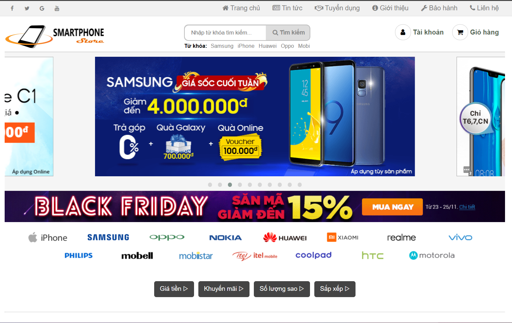
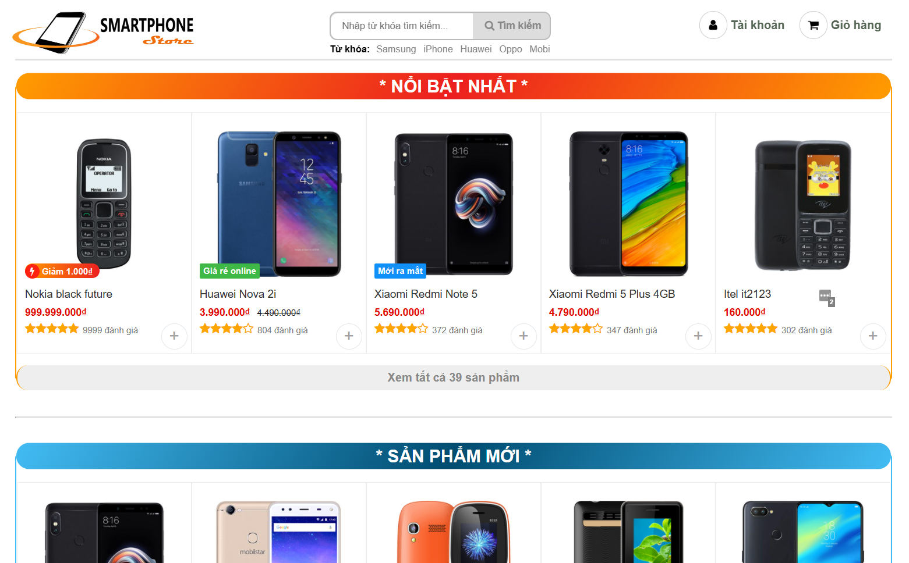
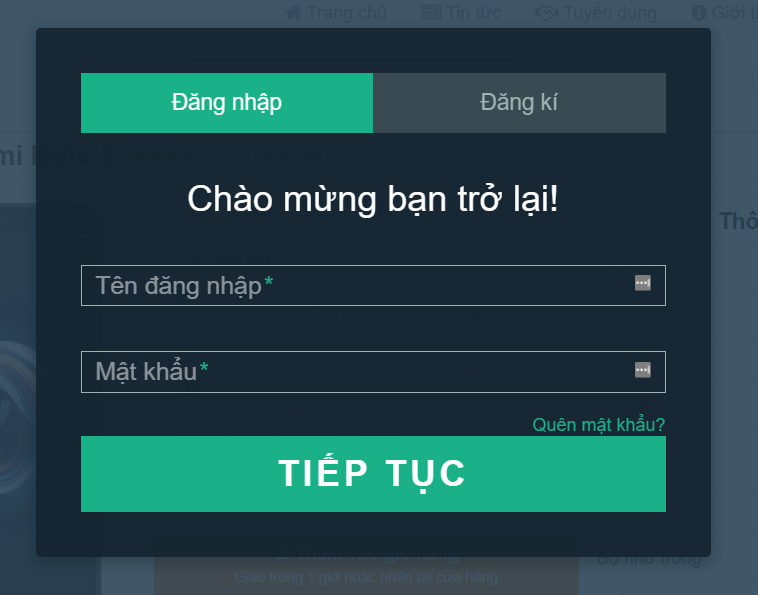
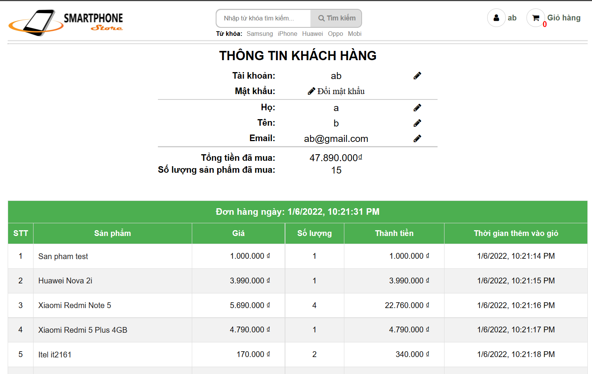
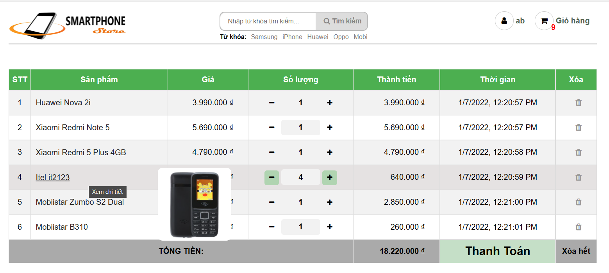
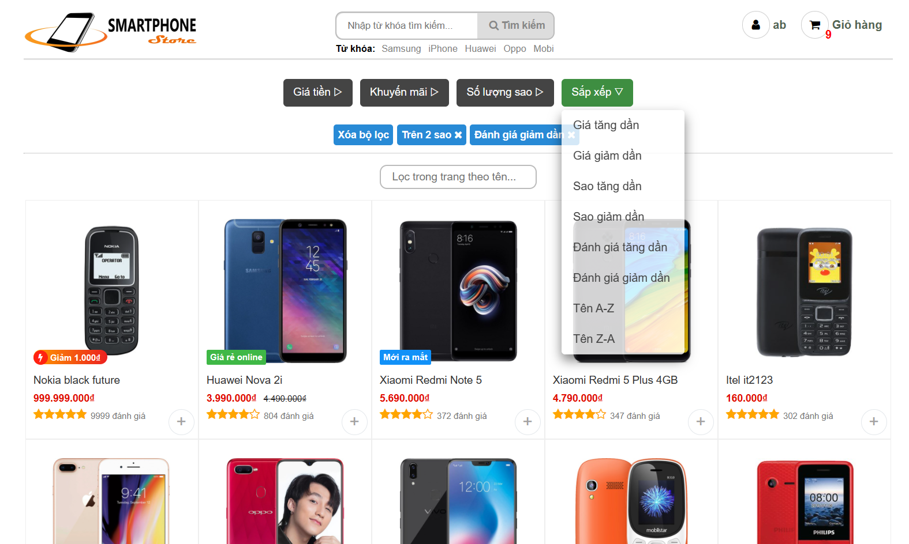
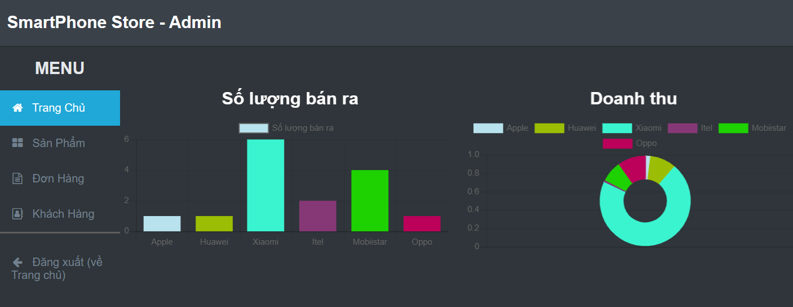
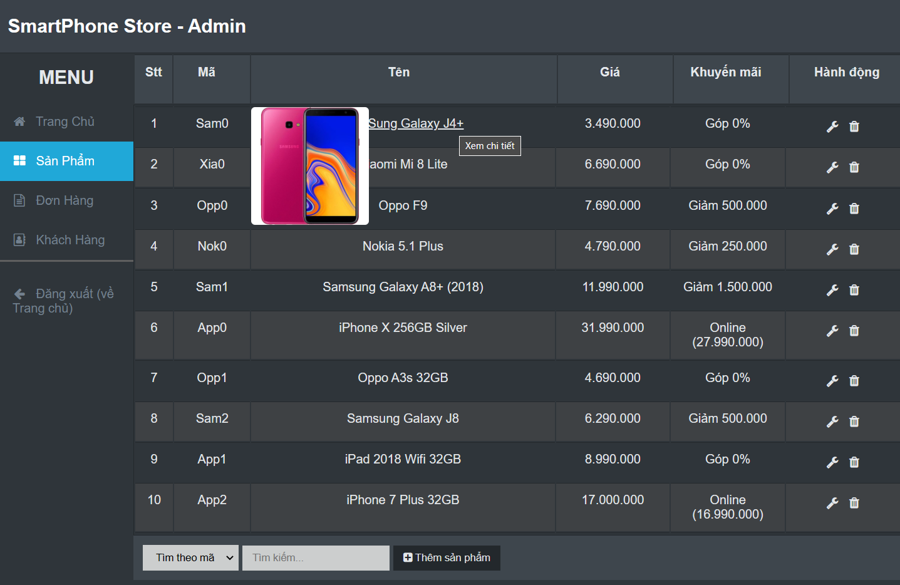
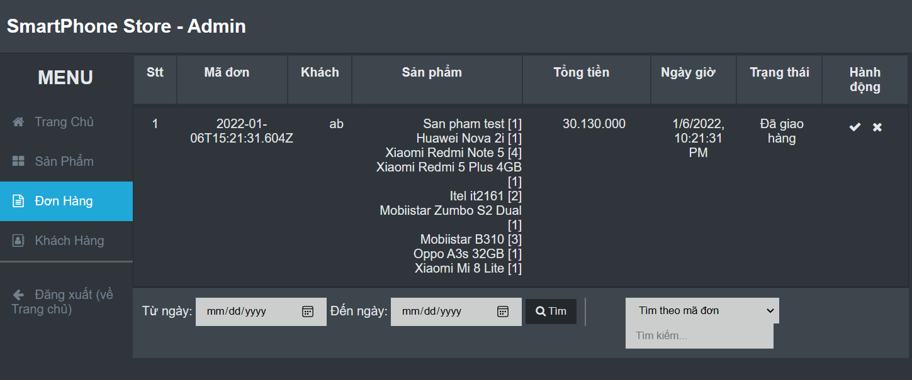
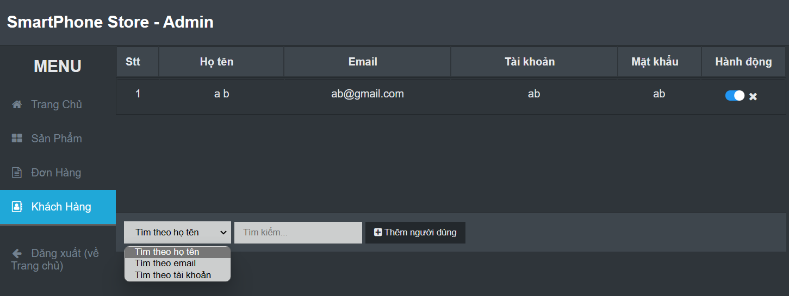

# DoAn_Web1

Donate? Muốn hỗ trợ mình 1 ly cafe <3 [Donate here](https://github.com/HoangTran0410/HoangTran0410/blob/main/DONATE.md)

Đồ án môn web 1, web tĩnh, đề tài trang web bán điện thoại.

Giao diện thân thiện, dễ sử dụng, chức năng khá đầy đủ.

Chức năng **Cơ bản**:

- Trang chủ hiển thị đẹp, các sản phẩm được chia theo nhiều tiêu chí: nổi bật, mới, khuyến mãi, giá rẻ, .. 
- Tìm kiếm/lọc/sắp xếp sản phẩm theo hãng, giá, tên, khuyến mãi, đánh giá, số sao, ...
- Đăng ký, đăng nhập, giỏ hàng, trang người dùng, lịch sử mua hàng.
- Trang chi tiết sản phẩm, giao diện **gợi ý sản phẩm** tương tự.

Chức năng **ADMIN**:

- **Thống kê** số lượng bán ra, doanh thu của từng hãng
- Danh sách **sản phẩm**, tìm kiếm/lọc, thêm/sửa/xoá sản phẩm
- Danh sách **đơn hàng**, tìm kiếm/lọc, duyệt/huỷ đơn hàng
- Danh sách **khách hàng**, tìm kiếm/lọc, thêm/xoá/khoá khác hàng

## Admin Account: 
+ username: admin
+ password: adadad

## Chạy trang quản trị với SQL Server

- Tạo database lần đầu bằng `backend/sql/setup_database.sql` trong SQL Server Management Studio. Không chạy lại script này trên database đang có dữ liệu vì script tạo lại các bảng.
- Nếu database đã được tạo trước đó, chạy `backend/sql/admin_migration.sql` một lần để cho phép lưu ảnh sản phẩm tải lên từ trang quản trị.
- Cấu hình kết nối SQL Server trong `backend/.env` (`DB_SERVER`, `DB_NAME`, `DB_USER`, `DB_PASSWORD`, và `DB_PORT` hoặc `DB_INSTANCE`).
- Chạy backend bằng `cd backend`, `npm install`, rồi `npm start`; mở trang qua `http://localhost:5000/admin.html` và đăng nhập bằng tài khoản admin ở trên.
- Sản phẩm, đơn hàng và khách hàng trên trang admin được đọc/ghi qua backend vào SQL Server. Đơn hàng được tạo khi khách thanh toán; đơn chờ xử lý có thể được khách hủy trong trang tài khoản hoặc được admin duyệt/hủy. Sản phẩm đã nằm trong đơn hàng không thể xóa để giữ lịch sử đơn hàng.

## Screenshots

### Cơ bản

Trang chủ

Sản phẩm trong trang chủ

Chi tiết sản phẩm

Đăng nhập

Đăng ký

Trang người dùng

Giỏ hàng

Tìm kiếm/lọc/sắp xếp sản phẩm

### Admin

Admin: Thống kê

Admin: Sản phẩm

Admin: Đơn hàng

Admin: Người dùng

